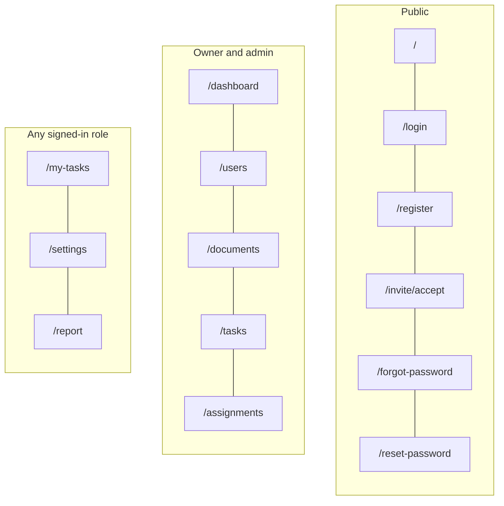

# LaunchDesk

Employee onboarding web app built with Next.js (App Router). It talks to a separate backend API for auth, tasks, documents, and assignments.

## Features



Lines stack routes top to bottom within each group; links are for layout only, not a required visit order. Detail and edit screens use the same prefixes, for example `/users/[id]`, `/documents/[id]`, `/my-tasks/[id]`.

- Sign-in supports email/password plus Google and GitHub OAuth on `/login` and `/register`.
- UI locales: English and Polish (per-user choice in `/settings`).

## Requirements

- **Node.js 22** (matches the [Dockerfile](Dockerfile) base image `node:22-alpine`)
- **npm** (this repo uses `package-lock.json`; CI and Docker run `npm ci`)
- A running **LaunchDesk backend API** (see `API_URL` below)

## Configuration

Copy the example env file and adjust values for your environment:

```bash
cp .env.example .env.local
```

| Variable | Purpose |
| --- | --- |
| `API_URL` | Backend API origin (default in example: `http://localhost:4000`) |
| `NEXT_PUBLIC_SITE_URL` | Public site URL for canonical links, Open Graph, sitemap (default: `http://localhost:3000`) |
| `NEXT_PUBLIC_GA_MEASUREMENT_ID` | Optional GA4 measurement ID (`G-…`). Leave empty locally; analytics and the cookie banner stay off when unset |

## Run and build

Install dependencies:

```bash
npm install
```

Development server (opens at [http://localhost:3000](http://localhost:3000)):

```bash
npm run dev
```

Production build and local production server:

```bash
npm run build
npm start
```

Other scripts:

```bash
npm run lint
npm run format
npm run format:check
npm run storybook          # http://localhost:6006
npm run build-storybook
```

Production images use Next.js `standalone` output (see [next.config.ts](next.config.ts)) and are built from the [Dockerfile](Dockerfile).

## Package versions

Versions below are pinned in [package-lock.json](package-lock.json) at the time of the last lockfile update.

| Package | Version |
| --- | --- |
| Node.js (Docker / recommended) | 22 |
| Next.js | 16.4.3 |
| React / React DOM | 19.2.4 |
| TypeScript | 5.9.3 |
| next-intl | 4.14.9 |
| TanStack Query | 5.105.0 |
| Zod | 4.6.7 |
| Sass | 1.106.1 |
| ESLint | 9.39.5 |
| Storybook | 10.6.4 |
